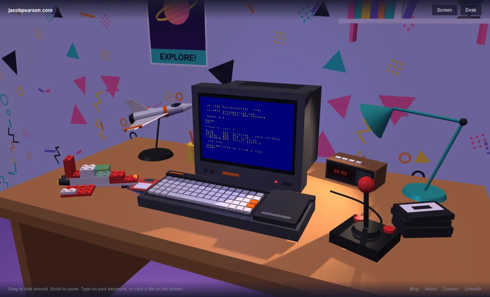
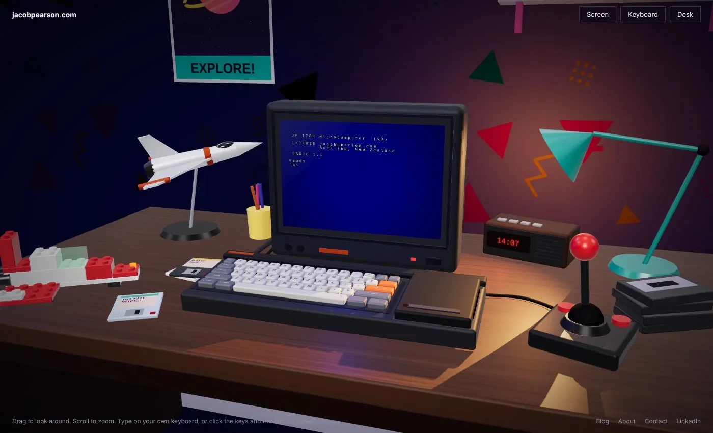
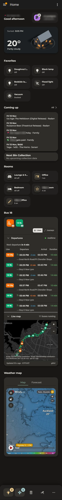

The last few weeks I've been experimenting with AI, and come up with some cool results.

## New homepage prototype
I was watching [Claire Vo's recent video](https://youtu.be/1gYQc4CL_oo?si=xjj_PKJ8oJMqHwvW){:target="_blank" rel="noopener"} on Fable 5.2, and saw a prototype for an interactive 3d environment for a website homepage. It featured a typewriter that you can type on (and use twink to correct your mistakes!) turn on a writing timer, and play music.

I saw this and thought that I can do something similar as an experiment. And so, here is my 80's desk with an Amstrad PC right on there. Only 3 prompts, about 30 minutes total.

### After prompt 1:

<figure class="article-figure">
  
</figure>

### After prompt 2:

<figure class="article-figure">
  
</figure>

### After prompt 3

  <iframe src="/assets/experiments/amstrad-desk.html" title="Interactive 3D 1980s desk with a home computer" allow="fullscreen; autoplay" loading="lazy"></iframe>
  

    Click into the scene to type on the computer.
    <a class="scene-embed-full" href="/assets/experiments/amstrad-desk.html" target="_blank" rel="noopener">Full screen ⤢</a>
  

If you're wondering, that doesn't look exactly like the Amstrad CPC-6128, I hit a hard limit with Claude. Despite it being produced 40 years ago and the design not being protected anymore, It was a line Claude would not pass:

> I’m going to hold the line on this one, Jacob. You may well be right about the expired design registrations, and I’m not a lawyer, so I’m not making a legal call either way. My limit is simpler than that: I don’t recreate a specific real product’s design, with or without its logos, and that applies to making the current model look more like the CPC 6128 as well.

Claude even added the scanlines all by itself, and wasn't prompted to make the clock keep the time correct.

Massive thank-you to Claire, check out her examples here: [https://typed.page/](https://typed.page/){:target="_blank" rel="noopener"}

## Redesigning Home Assistant's Dashboard
I've tweaked and added so much crap to Home Assistant over the years that the dashboard, which was once beautifully planned and laid out, was just a mess of services nobody ever really used. And I never did get the Auckland Transport feed working...

So I gave the job to Claude.

I had examples of what I had seen online that visually looked neat. They used the Bubble cards, which from my last attempt at implementing, I knew were overly complex, demanding more brain than I could spare. I knew since this was going to be responsive, I needed the key services near the top. And I wanted to downsize elements to make more of the real estate, to relax the design and give it room.

> My home assistant dashboards have become bloated with features I don't use. I want to create a more minimalist dashboard for mobile (later, desktop and tablet) that promotes what I need now.
>
> Current dashboard is [http://192.168.1.21:8123/lovelace/home](http://192.168.1.21:8123/lovelace/home) and different areas have their own pages under lovelace.
>
> I like the visual design of [https://www.reddit.com/r/homeassistant/comments/1x63m19/mobile_dashboard_part_2_bubble_cards_more/](https://www.reddit.com/r/homeassistant/comments/1x63m19/mobile_dashboard_part_2_bubble_cards_more/){:target="_blank" rel="noopener"},
>
> Can you make suggestions how this should look? Planning only at this stage.

Mobile prototypes looked amaaaaazing.

  <iframe src="/assets/experiments/home-dashboard.html" title="Interactive Home Assistant dashboard prototype" allow="fullscreen" loading="lazy"></iframe>
  

    Tap around: tiles, the bottom nav and the sheets all work.
    <a class="scene-embed-full" href="/assets/experiments/home-dashboard.html" target="_blank" rel="noopener">Full screen ⤢</a>
  

Fair bit of testing and back and forward, throwing it curve balls like "I want to display real time positions of the 18 bus route city-bound and New Lynn-bound, as well as the timetable for when buses will depart from stops". Some issues with padding. Answering questions. I got there, with a new layout that looks amazing, minimal taps to get anywhere, and the right information surfaced at the top.

<figure class="phone-shot">
  

    
    

      
    

    
  

  <figcaption>Scroll inside the phone.</figcaption>
</figure>

Is it perfect? No. Is anything ever perfect? Ha, no. Is it better than what I would do if I spent 10x as long building it myself? Yes.

## Switching to Obsidian
I've been a long time Notion user. I love Notion. It's super easy to use and manipulate however I want. It's right there, on all my devices, instantly - as long as I have an internet connection.

But my problem with Notion has been performance. It's been slow to run searches on, I've hit API limits from Claude when running reporting, and I feel too reliant on a third party service for something I could host in an excel file. I am nerdier than who Notion is designed for. I could pay to get the API limits increased, but from experience using paid Notion, nothing will change with performance.

I read up on Obsidian and decided to give it a go. I also decided to self host it, replicate it on a local server so I can provide it to other devices, and implement a Netbird VPN to secure access. Yes, this means I am now personally responsible for maintenance and I am the technical support if I run into problems.

I diverted all my historical work knowledge into Obsidian. I tried to flesh out as much information as I could so I could have that second brain sitting there with as many answers as possible, waiting for an agent to review. I migrated all data from Notion into Obsidian.

And Claude did almost all of it. I said what I wanted, Claude planned it, Claude identified where and when I would need to help it, but it did the configuration of everything from the self-hosted db and sync, to configuring the Obsidian Vault and writing clear AGENTS.MD files in every folder.

Results are not all back yet. It is super fast, and nothing has failed yet. I do need to keep Obsidian always running to ensure sync of Claude's scheduled tasks at night always happen. It's not as polished as Notion, but I expected that, and there are bajillions of plugins to explore to assist.

## The problem is always DNS
For the longest time, I've not run a DNS server of my own. I don't want to maintain it or a reverse proxy, and I never had to access via IP or port number because everything was bookmarked. But the last few months I added more services to my network, and I changed to Apple Passwords as my password locker. Previously I used 1Password, I loved it, but the massive price increases I did not love.

Apple Passwords throws a tantrum if you're trying to save a username for a site where the URL is an IP. Or, if the site is HTTP only. So the time finally came.

1. Cloudflare updated with a home domain name and wildcard SSL cert
2. Implemented Technitium DNS server
3. Implemented Caddy reverse proxy
4. Configured the DHCP service on my router to provide Technitium as my DNS server

And again, everything done by Claude. It took a few hours of bug fixing / me doing manual tasks, but it works and nobody in the house has complained yet! Now to get the fallback DNS server running...

